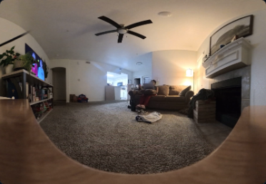
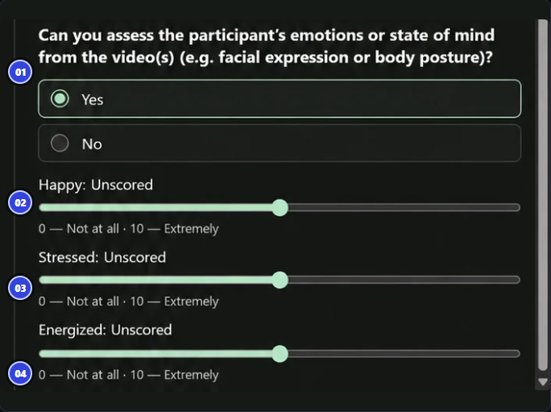

# Course Transcription

Source: `course.png` (815 × 13572 px). Sections are transcribed in the order they appear in the image, top to bottom. The image contains sections 6–22 only.

**Notes about the source**

- Section 19 is labeled "MODULE 1 · OVERVIEW" in the image, even though it sits between Module 5 sections (18 and 21). The label is kept as shown.
- Sections 12 and 13 show no module label in the image. They follow section 11 ("MODULE 3 · YOUR REVIEW") and carry the same `YOUR REVIEW` tag.
- Section 20 is plain text on a white background, not a course screenshot. Its typos and grammar were lightly corrected (for example, "vide" → "video").
- Section 22's tag says "11 answered questions", but the image shows 12 questions (4 in each of the 3 groups).
- The last FAQ question reads "speed up the making of the task" in the image. It is written here as "marking" to match section 20.
- The photos in sections 9 and 11 are the same picture with different captions.
- Section 11 was updated on 2026-10-15 from a newer screenshot of that slide. The Partly row's required next action changed from "select at least one video" to "select all videos where the action is partially evident". The rest of the slide is unchanged.
- A project clarification received on 2026-10-21 is added after section 22 as [Special note: Latest project guidance](#special-note-latest-project-guidance). It is not part of `course.png`. Where it differs from the course, the special note is the latest guidance.

**Transcription conventions**

- **Bold** text is bold in the course.
- Each section shows the module label printed above its title, exactly as it appears in the image.
- "Tags" are the two small labels printed under each section title.
- Blockquotes (`>`) are highlighted boxes. ℹ️ marks boxes that show an "i" icon in the course.
- `[ ]` items are checklist items (shown with empty checkboxes in the course).
- Curly quotes and apostrophes are written as straight quotes (`"` and `'`).
- Pictures embedded in the course are saved in `course_assets/`. Text inside a screenshot is also written out below it.

## Contents

- [6. Recognizing the diary and the video groups](#6-recognizing-the-diary-and-the-video-groups)
- [7. What you are reviewing](#7-what-you-are-reviewing)
- [8. Overlapping Videos vs Adjacent Videos](#8-overlapping-videos-vs-adjacent-videos)
- [9. Reading the diary Activity description](#9-reading-the-diary-activity-description)
- [10. Reviewing both groups of videos](#10-reviewing-both-groups-of-videos)
- [11. Is the Activity description clearly visible?](#11-is-the-activity-description-clearly-visible)
- [12. Activity evidence across multiple videos](#12-activity-evidence-across-multiple-videos)
- [13. Partly, hidden actions, and uncertain details](#13-partly-hidden-actions-and-uncertain-details)
- [14. Selecting evidence clips](#14-selecting-evidence-clips)
- [15. Selecting only qualifying video](#15-selecting-only-qualifying-video)
- [16. Checking Adjacent Videos and recording gaps](#16-checking-adjacent-videos-and-recording-gaps)
- [17. Revising a Partly description](#17-revising-a-partly-description)
- [18. Checking required answers and submitting](#18-checking-required-answers-and-submitting)
- [19. Feather: how to rate emotions](#19-feather-how-to-rate-emotions)
- [20. How to speed up the marking of a task](#20-how-to-speed-up-the-marking-of-a-task)
- [21. Reviewer check after submission](#21-reviewer-check-after-submission)
- [22. Diary Activity Review: FAQ](#22-diary-activity-review-faq)
- [Special note: Latest project guidance](#special-note-latest-project-guidance) *(added 2026-10-21, not in `course.png`)*

---

## 6. Recognizing the diary and the video groups

*MODULE 1 · OVERVIEW*

Tags: `ORIENTATION` · `what to look for`

Begin with the **participant's diary Activity description** and its reported time window. The video groups organize the available evidence by time, not by certainty.

| ON THE TASK | WHAT IT MEANS | WHAT TO DO |
|---|---|---|
| Activity description | Participant's reported activity | Compare each claim to what can be heard and/or seen. |
| Overlapping Videos | Recordings within the reported time window | Review them as the most likely place to find evidence. |
| Adjacent Videos | Recordings outside the reported time window | Review them even when the overlapping recordings already confirm the activity. |

> ℹ️ **DO NOT OVER-TRUST TIMESTAMPS**
>
> The reported time window may be wrong. A clip outside that window can still provide important evidence.

---

## 7. What you are reviewing

*MODULE 1 · OVERVIEW*

Tags: `OVERVIEW` · `evidence first`

Your job is to check whether the diary's **Activity description** is confirmed by recorded evidence. Listen as well as watch, select relevant clips, and assess emotions only from observable visual and/or audio cues.

- **Activity evidence:** What can be clearly confirmed by audio, video, or both?
- **Completeness:** Does the evidence support the full description, part of it, or none of it?
- **Video selection:** Which overlapping and adjacent clips qualify?
- **Emotions:** Do observable cues support ratings for Happy, Stressed, and Energized?

> **EVIDENCE STANDARD**
>
> Search for evidence of the activity. Select Yes if the evidence fully confirms it, or Partly if the evidence is insufficient to confirm it completely.

---

## 8. Overlapping Videos vs Adjacent Videos

*MODULE 1 · OVERVIEW*

Tags: `VIDEO GROUPS` · `both required`

The difference between the two video groups is their relationship to the **reported time window**. Either group can contain evidence that supports Yes or Partly.

| GROUP | TIME RELATIONSHIP | REVIEW RULE |
|---|---|---|
| **Overlapping Videos** | Within the reported window | These are likelier to contain the reported activity so start here; inspect available audio and video. |
| **Adjacent Videos** | Outside the reported window | Check these too, even when overlapping videos already show the reported activity. |

> **KEY RULE**
>
> Do not stop searching as soon as you find one qualifying clip. **Select all qualifying videos from both groups.**

> ℹ️ **A TIME MISMATCH IS NOT A VISIBILITY VERDICT**
>
> Decide "Yes" / "Partly" / "No" from how much of the Activity description the evidence confirms—not whether the activity falls inside the participant's reported time window.

> ℹ️ **NO OVERLAPPING VIDEOS ARE REPORTED**
>
> Even if there are no overlapping videos, the task should still be completed as usual.

---

## 9. Reading the diary Activity description

*MODULE 2 · READ THE DIARY AND WATCH*

Tags: `READ AND WATCH` · `start with the diary`

Read the participant's **Activity description** and **reported time window** before opening the recordings. The description may contain several claims, and each claim must be checked against audio and/or video.

### Separate the action from details

For "I was playing games on my phone," the description includes both phone use and playing a game. Seeing a phone alone does not confirm the game.

> **EXAMPLE · SITTING ON A COUCH**
>
> 
>
> **Activity name:** Playing games in my PC.
>
> **What is visible:** A person is sitting on a couch.
>
> **What is unclear:** What they are doing beyond sitting. The image alone does not confirm a more specific activity.

### Check context but do not infer

A room that looks like an office does not prove that computer use is work. Supporting evidence must show or audibly establish the claimed activity.

### Use the available recordings

Captions or summaries may help you locate a segment, but confirm the activity using the underlying audio and/or video.

> ℹ️ **IMPORTANCE OF THE CONTEXT**
>
> While the context and details should not be used as conclusive evidence, if all we have are videos that show something related to the Activity description but do not fully confirm it, we should select **partly**.

> ℹ️ **TIME WINDOW**
>
> Treat the reported time window as a search cue, not proof of when the activity happened.

---

## 10. Reviewing both groups of videos

*MODULE 2 · READ THE DIARY AND WATCH*

Tags: `READ AND WATCH` · `check adjacent too`

Watch and listen to the **Overlapping Videos** and the **Adjacent Videos**. The reported time window may be inaccurate, and adjacent videos may contain additional qualifying evidence.

**Overlapping Videos → Adjacent Videos → Compare claims → Report every matching video**

- [ ] Review the Overlapping Videos inside the reported window.
- [ ] Check Adjacent Videos outside the reported window **even if the activity is already confirmed**.
- [ ] For every video, identify if part of the Activity description is supported by video, audio, or both.
- [ ] Keep track of all videos that clearly or partially show the reported activity.

> ℹ️ **CAPTIONS AND GAPS**
>
> Captions can help find a passage, but recordings are the evidence. Do not assume an unseen or unheard action happened during a recording gap.

---

## 11. Is the Activity description clearly visible?

*MODULE 3 · YOUR REVIEW*

Tags: `YOUR REVIEW` · `Yes · Partly · No`

The question asks whether the **Activity description can be confirmed through audio and/or video**. "Visible" in the field label includes qualifying audio evidence.

| ANSWER | CHOOSE WHEN | REQUIRED NEXT ACTION |
|---|---|---|
| **Yes** | The described activity is clearly confirmed by audio and/or video. | Select all clips supporting the described activity. At least one video must be selected. |
| **Partly** | Only part of the described activity can be confirmed. | Describe only the supported portion; select all videos where the action is partially evident. |
| **No** | There is no audio or video in the clips confirming that the described activity occurs. | Explicitly select **None of these videos**. |

*Added 2026-10-21, not in `course.png`: No also applies when the activity clearly fails a required condition in the description. See [Special note](#special-note-latest-project-guidance).*

### Example · Playing games in my PC

> **REVIEW THE EVIDENCE**
>
> 
>
> **Activity name:** Playing games in my PC.
>
> **What is visible:** A person is sitting on a couch and using a PC.
>
> **What is unclear:** The specific activity on the PC. The video and audio do not confirm that the person is playing games.

> **CONCLUSION · PARTLY**
>
> **PC use is supported**, but the video and audio do not confirm that the person is playing games. Choose **Partly** because only the general computer use can be confirmed, not the specific activity claimed in the diary. A supported revised description would be **"Using my PC."** Select all qualifying videos that show this part of the activity.

> **IMPORTANT DISTINCTION**
>
> Judge the **description's supported content**, not whether the activity is entirely inside the reported time window.

---

## 12. Activity evidence across multiple videos

*(no module label shown in the image)*

Tags: `YOUR REVIEW` · `combine evidence`

Different videos may support different parts of an Activity description. Review both groups (Overlapping and Adjacent) and select **all** that clearly or partially show the activity.

### Example: preparation and eating

Activity: "Lunch preparation and having lunch." Videos 1 and 2 show cooking; videos 3 and 4 show eating. **Select videos 1, 2, 3, and 4, and choose "YES" because the videos fully show the activity.**

### What if only one part appears?

If cooking is shown but eating is not confirmed anywhere, choose **Partly**, describe the confirmed preparation, and select all videos where preparation happens.

### What if the actions happen outside the reported window?

Still consider them. Adjacent Videos can support the activity because the reported time window may be wrong.

> ℹ️ **UPDATED SELECTION RULE**
>
> Select all relevant videos. Do **not** select only the smallest number needed to demonstrate the activity.

---

## 13. Partly, hidden actions, and uncertain details

*(no module label shown in the image)*

Tags: `YOUR REVIEW` · `common cases`

Choose **Partly** when the available audio and/or video confirms an action but not an important detail included in the Activity description.

| DESCRIPTION | EVIDENCE | CORRECT JUDGMENT |
|---|---|---|
| "I was playing games on my phone." | The participant uses a phone, but the game cannot be seen or heard. | **Partly** → "I was on my phone." |
| "I was working on my computer." | Computer use is clear; working cannot be verified. | **Partly** → "I was using my computer." |
| "I was cooking lunch and then ate it." | Only cooking is confirmed. | **Partly** → describe the cooking only. |
| "I was playing a game." | No audio or visual evidence confirms any claimed action. | **No** → choose "None of these videos". |

*Added 2026-10-21, not in `course.png`: an unverified condition stays Partly, but a clearly contradicted condition is No. Device use must be active, not just sitting near a device. See [Special note](#special-note-latest-project-guidance).*

> **DESCRIBE FACTS, NOT GUESSES**
>
> For Partly, use the narrowest accurate revision supported by the recordings. A plausible interpretation is not confirmation.

---

## 14. Selecting evidence clips

*MODULE 4 · VIDEO SELECTION*

Tags: `VIDEO SELECTION` · `all qualifying videos`

After choosing Yes, Partly, or No, complete the video-selection question. Inspect both **Overlapping Videos** and **Adjacent Videos**.

| VISIBILITY ANSWER | VIDEO-SELECTION REQUIREMENT |
|---|---|
| Yes | The described activity is clearly confirmed by audio and/or video. |
| Partly | Select if only part of the described activity can be confirmed through audio and/or videos. |
| No | There is no audio or video in the clips confirming that the described activity occurs. |

> ℹ️ **VIDEO-LEVEL EVIDENCE**
>
> A qualifying clip may establish an activity visually, audibly, or through both. Selection is not restricted to the reported window.

---

## 15. Selecting only qualifying video

*MODULE 4 · VIDEO SELECTION*

Tags: `VIDEO SELECTION` · `select all`

Use the **all qualifying videos** rule.

### Example 1: select all videos that support

Videos 1 and 2 contain lunch preparation and cooking; videos 3 and 4 contain eating. The correct selection is **1, 2, 3, and 4**.

### Example 2: repeated evidence

Two clips show the same supported action. Select **both** if each qualifies.

### Example 3: audio-only confirmation

The action is audibly confirmed while the camera view does not clearly reveal it. Include that video.

### Example 4: unrelated footage

A video contains neither clear nor partial support for the activity. Do not include it merely because it overlaps the reported window.

---

## 16. Checking Adjacent Videos and recording gaps

*MODULE 4 · VIDEO SELECTION*

Tags: `VIDEO SELECTION` · `check both groups`

A reported time window can be inaccurate. Examine Adjacent Videos **regardless of whether the activity appears in Overlapping Videos**.

- [ ] Check videos within the reported window.
- [ ] Check videos outside that window as well.
- [ ] Include all videos that clearly or partially confirm the activity.
- [ ] Do not infer what happened inside an unavailable recording gap.
- [ ] Do not include adjacent footage solely because it is nearby in time.

> **IF EVIDENCE IS FRAGMENTED**
>
> Use every segment that is actually available and supportive; **combine evidence across videos** without assuming missing parts.

---

## 17. Revising a Partly description

*MODULE 5 · REVIEW DETAILS AND SUBMITTING*

Tags: `REVIEW DETAILS` · `state only confirmed parts`

When you answer **Partly**, you will see an additional question "*What part of the activity is visible?*". Describe the portion of the Activity description that the audio and/or video actually supports and explain why partly was selected.

| ORIGINAL ACTIVITY | CONFIRMED EVIDENCE | ANSWER TO "WHAT PART OF THE ACTIVITY IS VISIBLE?" |
|---|---|---|
| "I was playing games on my phone." | Visible phone use; no evidence of a game. | The person is shown on their phone, but it is impossible to confirm whether they were playing. The description could be changed to "I was on my phone." |
| "I was working on my computer." | Computer use; no confirmation of work. | The videos show the person using the computer, but the screen is not visible, so we do not know what they were doing. "I was using my computer." would be a better description |

> **KEEP OBSERVATIONS SEPARATE FROM EXPLANATIONS**
>
> The revised description is a supported statement about activity, not an inference about intent, work, entertainment, or mood.

---

## 18. Checking required answers and submitting

*MODULE 5 · REVIEW DETAILS AND SUBMITTING*

Tags: `SUBMISSION` · `validation`

Before submission, verify every required response. **Missing answers block submission.** Use the form's validation errors to locate and complete any omissions.

- [ ] The "Is the Activity description clearly visible?" question has a Yes, Partly, or No answer.
- [ ] If Partly: a revised description states only the portion confirmed through audio and/or video.
- [ ] If Yes or Partly: at least one video is selected, and all qualifying overlapping and adjacent videos are included.
- [ ] If No: **None of these videos** is explicitly chosen.
- [ ] If videos are selected: the emotion-assessment question is answered Yes or No.
- [ ] If emotions = Yes: **Happy, Stressed, and Energized** are all explicitly scored from 0 to 10.
- [ ] If emotions = No proceed directly to submission.

**Review fields → Fix errors → Submit**

---

## 19. Feather: how to rate emotions

*MODULE 1 · OVERVIEW*

Tags: `EMOTION ASSESSMENT` · `3 ratings · 0 to 10`

After selecting videos, decide whether the participant's **observable visual and/or audio cues** allow an emotion assessment. If they do, rate **Happy, Stressed and Energized** separately, based on the most obvious and persistent state during the activity.

### FEATHER EMOTION FIELDS · SCREENSHOT

Text in the screenshot (numbered markers 01–04 point to each field):

- **01** — Can you assess the participant's emotions or state of mind from the video(s) (e.g. facial expression or body posture)?
  - (●) Yes
  - ( ) No
- **02** — Happy: Unscored — slider — 0 — Not at all · 10 — Extremely
- **03** — Stressed: Unscored — slider — 0 — Not at all · 10 — Extremely
- **04** — Energized: Unscored — slider — 0 — Not at all · 10 — Extremely

Choose a numbered guide card to highlight its field. The screenshot shows **Unscored** sliders, not completed ratings.

### HOW TO USE THE FIELDS

**01 · Can you assess emotions?**
Use facial expression, body posture and/or audible cues such as voice tone. Choose **Yes** when there is enough evidence to rate them. Otherwise choose **No**, without scores.

**02 · Happy**
How strongly do the observed cues support happiness during the activity?

**03 · Stressed**
How strongly do the observed cues support stress? Do not assume stress from the situation alone.

**04 · Energized**
How strongly do the observed cues support an energized state? Rate this separately from the other two dimensions.

> **EACH SLIDER USES THE SAME SCALE**
>
> **0 · Not at all** ———————— **10 · Extremely**
>
> If you choose **Yes**, you must **explicitly set all three sliders**. The scale ranges from 0 to 10, where 0 indicates no evidence of the emotion, and 10 indicates a very strong emotion.

> **DO NOT RATE ONE BRIEF REACTION** (red box)
>
> A person browses the internet, laughs at one video, then returns to ordinary browsing. Do not rate the entire activity from that one laugh.

> **RATE THE SUSTAINED STATE** (green box)
>
> Base each rating on the **most obvious and persistent** observable state across the selected activity.

---

## 20. How to speed up the marking of a task

*(In the image, this section is plain text on a white background, not a course screenshot. Typos and grammar lightly corrected.)*

There is a video section here that explains that using the command Ctrl + F is useful for reviewing long videos based on the caption texts. It is always important to check the video as evidence where the caption contains the keyword. The evidence is the video, not the caption.

---

## 21. Reviewer check after submission

*MODULE 5 · REVIEW DETAILS AND SUBMITTING*

Tags: `AFTER SUBMITTING` · `existing process`

After submitting, the task moves to the existing **Reviewer check** stage.

- A reviewer can **approve** the task as is or **edit your existing answers** directly.
- In either case, they'll give you feedback that you should keep in mind for future tasks.
- The purpose of feedback is not to point out mistakes but to **improve and enhance** the quality of the deliverables.

---

## 22. Diary Activity Review: FAQ

*MODULE 1 · FREQUENTLY ASKED QUESTIONS*

Tags: `CLARIFICATIONS` · `11 answered questions`

These answers clarify common edge cases in **Feather**. Open a question to see the guidance. Apply the same evidence rules to both Overlapping Videos and Adjacent Videos.

### 01 Finding and selecting videos

#### If the full activity appears in Adjacent Videos, should I choose Yes or Partly?

Choose **Yes** if the recordings fully confirm the activity. The choice depends on the evidence, not on whether a clip is Overlapping or Adjacent. Select all videos that show the activity.

#### What if there are no Overlapping Videos?

Review **all available videos**, including Adjacent Videos. The reported time window does not limit where the activity can be found.

#### Can several videos together support a Yes answer?

**Yes.** Judge the videos together. For example, if Videos 1 and 2 show preparing lunch and Videos 3 and 4 show eating lunch, all four together can confirm "preparing and eating lunch." Select all four.

#### Should I select a second video if the activity continues for only a few seconds?

**Yes.** Select every video that shows the activity, even if only a short part of it appears in the next clip. Select entire videos in Feather, not custom time ranges.

### 02 Assessing the evidence

#### Does Partly mean that the activity happened outside the reported time window?

**No.** Partly means the available audio and/or video confirms only a portion of the claimed activity. Timing alone does not make an activity Partly.

#### Do I consider the Activity name or the Activity description?

Consider **both**, but prioritize the **Activity Description** if they contradict (though they should be related). For example, if the name says "Tidying up the house" but the description specifies "downstairs," and the location cannot be confirmed, choose **Partly**.

#### If I see someone using a phone and hear a game, is that enough to confirm gaming?

Only when it is **clearly evident that the person is playing the game**. Phone use and game sounds alone do not automatically prove who is playing. Do not infer an action that the evidence does not clearly support.

#### What are the required actions for Yes, Partly, and No?

**Yes:** The activity is fully supported; select at least one matching video. **Partly:** Only a portion is supported; explain that portion and select at least one matching video. **No:** The activity is unconfirmed; select **None of these videos**.

### 03 Writing answers and rating emotions

#### Does a Partly explanation have to be written in the first person?

**No.** There is no required point of view or writing format. Explain clearly what is supported and why.

#### What do I write if only audio supports part of the activity?

Choose **Partly** when the audio confirms only a portion. Describe the relevant sound or speech, where you found it, and how it supports that part of the activity.

#### Can I use audio to assess emotions?

**Yes.** Use observable **audio and visual cues**, such as voice tone, facial expressions or body posture. Do not infer the participant's internal emotional state.

#### How can I speed up the marking of the task?

You can use the **Caption** and **Summary** sections to search for key terms related to the activity. Please keep in mind that captions and summaries may not always be accurate; you bear the final responsibility for correctly marking matching videos.

---

## Special note: Latest project guidance

*Not part of `course.png`. Project clarification received on 2026-10-21, to be used alongside the course. Where it differs from the course, this note is the latest guidance. Text kept as received.*

Please use these alongside the latest project guidance:

### Evidence first

Confirm activities through the actual video and/or audio. Captions and summaries can help locate evidence, but are not proof. Do not infer actions from recording gaps, nearby objects, or what someone might be doing.

### Computer and phone use

Studying, writing, and working can happen digitally, pens and paper are not required. However, device use alone does not confirm the specific purpose. If active device use supports part of the description but the purpose remains unverified, choose Partly and explain the limitation. Simply sitting near a device is not enough.

### "Diary" and "recording"

Do not assume that these terms mean everything captured by the camera. Having footage does not automatically confirm diary work or actively starting/managing a recording. Select evidence supporting the described action, and note uncertainty where the meaning is unclear.

### Which videos to select

Review both Overlapping and Adjacent Videos, even after finding a match. Select all qualifying clips, including partial support and brief occurrences. "Started" or "continued" does not mean selecting only the first clip.

### Time, location, and restrictions

The reported window is a search cue, not a strict boundary. However, explicit conditions within the description matter: "studying in bed", "dinner with family", or doing two things simultaneously should not be treated as unrestricted activities.

Distinguish an unverified condition from a clearly contradicted condition. Under the latest announcement, studying at a desk instead of in bed, or clearly eating alone instead of with family, is No. Someone being off camera does not automatically establish that they are absent.

### Yes / Partly / No

- **Yes:** the full description is confirmed across the available evidence.
- **Partly:** a relevant action or portion is confirmed, but other details remain unverified.
- **No:** no relevant action is supported, or the activity clearly fails a required condition under the latest guidance.

### What to write for Partly

Describe the supported portion and explain what cannot be verified. Do not list unrelated activities or rewrite assumptions as facts.

> **EXAMPLE**
>
> "The participant is using a laptop, but the recordings do not confirm that they are rewriting their screenplay".

### Where this note changes or extends the course

*Comparison added by the transcriber. Not part of the clarification text.*

| TOPIC | COURSE | THIS NOTE |
|---|---|---|
| When to answer No | Section 11: no audio or video confirms that the activity occurs. | Also No when the activity clearly fails a required condition, such as studying at a desk instead of in bed, or clearly eating alone instead of with family. |
| Unverified condition | FAQ: location named in the description but not confirmable ("downstairs") is Partly. | Same. Only a clearly contradicted condition is No. Someone off camera is not proof they are absent. |
| Device use | Section 13: device use without a confirmed purpose is Partly. | Same, but use must be active. Sitting near a device is not enough. Studying, writing and working can be digital. |
| "Diary" and "recording" | Not covered. | Having footage does not confirm diary work or actively starting or managing a recording. Note uncertainty. |
| "Started" or "continued" | FAQ: select every video showing the activity, even a few seconds of it. | States outright that these words do not mean selecting only the first clip. |
| Partly text | Section 17: describe the supported portion and why Partly was chosen. | Also state what cannot be verified. Do not list unrelated activities. |
